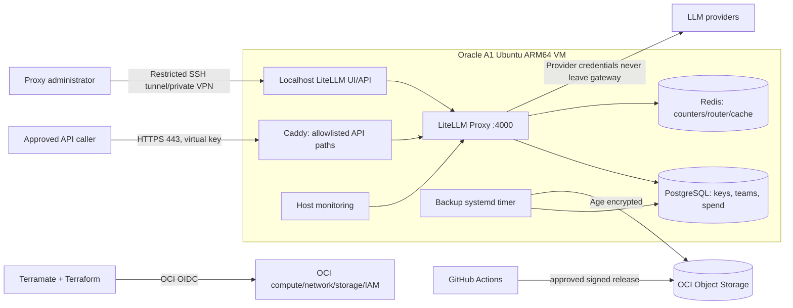

# llm-gateway — Complete implementation and infrastructure plan

**Status:** design / implementation backlog, not deployed.  
**Repository target:** `eslam-aboutaleb/llm-gateway` (proposed; create separately).  
**Reviewed:** 2026-10-23.  
**Scope:** gateway and platform only. Changes to consuming applications are expressly excluded.

## A. Mission, design principles, boundaries

Build a recoverable, inexpensive, administrator-managed **LiteLLM Proxy** service that exposes a stable, authenticated OpenAI-compatible HTTPS API to approved users and services, centralizes upstream model credentials, and enforces per-key/team access and spending limits.

**In scope:** LiteLLM Proxy, Oracle OCI infrastructure, ARM64 validation, Terramate + Terraform, hardened Ubuntu, Compose, PostgreSQL, Redis, Caddy, DNS/TLS, administrator-only key management, user onboarding, backups/restore, metrics/alerts, GitHub Actions, runbooks, and verification.

**Out of scope:** migrating consumer repositories; writing agent orchestration; building a custom OpenAI-compatible API; deploying GPU models; Kubernetes; multi-region failover; customer billing or a public self-signup portal; a bespoke dashboard; automatic approval of arbitrary requests.

**Principles:** use the unmodified official proxy; explicit config and image digests; minimal exposed ports; no administrative API on public ingress; no secrets in Git/Terraform user data/state/CI logs; fail closed on authorization; manual approval of key grants and production changes; test restore, not just backup; prefer off-VM recovery to pretend high availability.

## B. Foundational decisions and capacity

| Decision | Initial implementation | Upgrade trigger |
|---|---|---|
| Compute | OCI Always Free `VM.Standard.A1.Flex`, 2 OCPU, 12 GB RAM, ARM64 | Sustained high CPU/memory, reclaim, or required availability |
| OS | Pinned, supported OCI Ubuntu ARM64 image; document exact OCID/build | Security lifecycle |
| Storage | Proposed 100 GB boot volume; conserve 200 GB free combined block/boot quota | Disk utilization or IOPS |
| Off-node storage | OCI Object Storage, 20 GB total free allowance; separate `tfstate` / `backups` prefixes or buckets | DB growth or version accumulation |
| TLS | Domain DNS A record, Caddy ACME cert renewal, ports 80 and 443 | Managed DNS/certificate need |
| Gateway | LiteLLM monolith, 1 worker, official signed image pinned by digest | Measured throughput requires change |
| Data | Local persistent PostgreSQL and Redis | Higher reliability requirements |
| Orchestration | Docker Compose via `systemd`; Terramate owns Terraform, not containers | Multi-node transition |
| Access | Public inference paths only; admin UI/API via SSH tunnel or private administrative network | SSO / external administrators |
| CI | GitHub Actions; `ubuntu-24.04-arm` for native tests; OCI OIDC for privileged runs | Policy/volume changes |
| Deployment | Approved release manifest staged in OCI Object Storage, pulled by VM with instance-principal read access | Need more immediate rollout |

**Capacity cautions:** OCI free resource availability is region/account dependent; A1 instances can be reclaimed when idle. OCI Object Storage's 20 GB quota includes versioned objects and backups. A 100 GB boot volume consumes free block allocation. DNS domain registration and upstream LLM tokens are separate costs; OCI limits are not contractual uptime guarantees.

**Starting memory envelope (tune by load test):** LiteLLM max ~5 GiB; PostgreSQL ~1.5 GiB; Redis ~0.5 GiB; Caddy ~0.25 GiB; exporters/logging ~0.5 GiB; preserve >= 3 GiB for OS/page cache/burst. Keep **one** proxy worker initially; no replica-induced overcommit.

## C. Logical and trust architecture



**Network design:** one VCN, public subnet, route via Internet Gateway, one instance/VNIC/public IP, Network Security Group allowing TCP 443 from internet, TCP 80 only for ACME HTTP validation/redirect, SSH TCP 22 only from a designated administrator CIDR (or no public SSH with a verified private access solution); permit outbound DNS, NTP, HTTPS and required OCI services. Docker host binds LiteLLM port 4000 to **127.0.0.1 only**; PostgreSQL 5432 and Redis 6379 are attached only to the private Compose network. Do not create public NSG rules for 4000, 5432, 6379, Prometheus or admin endpoints. Apply both OCI and OS firewall policy; avoid contradictory Docker/UFW assumptions by testing from a remote network.

**Ingress:** Caddy terminates TLS. An explicit allowlist proxies supported inference routes (initially `/v1/chat/completions`, `/v1/embeddings`, `/v1/models`; add other routes only with contract tests). All management routes including `/ui`, `/key/*`, `/team/*`, `/user/*`, `/config/*`, `/spend/*`, API docs and unknown paths return a denial at the *public* ingress. Do not rely on the admin UI password to protect publicly exposed management APIs. Public `/status` is an optional minimal synthetic status with no sensitive readiness detail. Management stays accessible locally over a secured administrator tunnel. A Caddy-only Basic Auth wrapper is **not** suitable for protecting the same API route because it can interfere with the application Bearer header.

## D. Repository structure and file ownership

```text
llm-gateway/
├── README.md                              # Operator-facing entry point
├── terramate.tm.hcl                       # Global Terramate settings
├── LICENSE
├── .gitignore / .gitattributes / .editorconfig
├── .env.example                           # Variable NAMES only; fake examples
├── .github/
│   ├── CODEOWNERS
│   ├── ISSUE_TEMPLATE/access-request.yml  # No secrets allowed
│   ├── pull_request_template.md
│   ├── dependabot.yml
│   └── workflows/
│       ├── validate.yml
│       ├── arm64-compatibility.yml
│       ├── security.yml
│       ├── infra-plan.yml
│       ├── infra-apply.yml
│       ├── release.yml
│       ├── deploy.yml
│       ├── drift.yml
│       └── disaster-recovery-test.yml
├── infrastructure/
│   ├── bootstrap/                          # one-time state bucket + initial IAM trust setup
│   ├── modules/
│   │   ├── network/                        # VCN/subnet/IGW/NSG/security
│   │   ├── compute/                        # ARM A1, image, cloud-init
│   │   ├── storage/                        # buckets, lifecycle, versioning
│   │   ├── identity/                       # dynamic group and least privilege
│   │   └── alarms/                         # OCI notifications/budgets if free eligible
│   └── stacks/oci/production/
│       ├── stack.tm.hcl
│       ├── versions.tf / providers.tf
│       ├── backend.tf / main.tf / variables.tf / outputs.tf
│       └── terraform.tfvars.example
├── cloud-init/
│   ├── init.yaml.tftpl
│   └── files/                               # hardened systemd templates
├── gateway/
│   ├── config/litellm.yaml
│   ├── config/model-catalog.yaml
│   ├── compose.yaml / compose.dev.yaml
│   ├── caddy/Caddyfile
│   ├── postgres/init/                      # no embedded secrets
│   └── monitoring/                         # scrape targets and alert rules
├── scripts/
│   ├── check-arm64.sh / verify-images.sh
│   ├── bootstrap-secrets.sh                # operator run; no secret echo
│   ├── validate-config.sh
│   ├── admin-create-team.sh
│   ├── admin-issue-key.sh
│   ├── admin-revoke-key.sh
│   ├── deploy-release.sh / rollback.sh
│   ├── backup-postgres.sh / verify-backup.sh / restore-postgres.sh
│   └── smoke-test.sh / verify-network.sh
├── tests/
│   ├── unit/ / configuration/
│   ├── contracts/
│   ├── integration/
│   ├── security/
│   ├── arm64/
│   ├── performance/
│   └── restore/
└── docs/
    ├── USER_README.md                    # User instructions + request a key
    ├── ADMIN_KEY_RUNBOOK.md              # Private admin procedure
    ├── KEY_POLICY.md                     # Public entitlement policy
    ├── ARCHITECTURE.md / THREAT_MODEL.md
    ├── OCI_BOOTSTRAP.md / TERRAMATE.md / CONFIGURATION.md
    ├── DEPLOYMENT.md / UPGRADE.md / ROLLBACK.md
    ├── BACKUP_RESTORE.md / MONITORING.md / TROUBLESHOOTING.md
    └── ADR/                              # Architecture decision records
```

Use existing central `eslam-aboutaleb/ci-workflows` for applicable shared lint/security/test workflows, pinned by reviewed SHA. Keep OCI provisioning and release delivery jobs in this repository.

## E. Phase 0 — Investigate and validate upstream artifacts (P0; blocked until done)

1. Choose a **specific** LiteLLM release (not `latest`), identify image digest and upstream changes/security notices; record version in lock metadata.
2. `docker buildx imagetools inspect ghcr.io/berriai/litellm:<pin>`; require `linux/arm64`. Independently inspect Postgres, Redis, Caddy, exporters and backup tooling. Check architecture of migrations/Prisma binaries, not merely manifest metadata.
3. Verify upstream image signatures with cosign and an independently pinned LiteLLM public key. Resolve and deploy digest, not mutable tag. Generate an SBOM and container vulnerability report.
4. Run native `ubuntu-24.04-arm` GitHub-hosted tests: pull pinned images, start Postgres, execute the release's documented migration command, start LiteLLM, ensure readiness and UI assets, generate scoped virtual key in test DB, complete a mocked provider chat call, embed, and revoke. No live provider secrets in PR jobs.
5. Confirm Docker/Compose and guest OS compatibility on actual Oracle A1 separately before production cutover; no QEMU fallback. Test container read/write permissions if choosing non-root image.
6. Record a support matrix containing image digest, architecture, migrations, feature probes, and pass/fail evidence. If a release fails: block rollout or select another signed release—do not patch upstream ad hoc.

**Acceptance:** all required images support ARM64; native full-stack smoke test passes; signed digest recorded; migration lifecycle and rollback behavior documented.

## F. Phase 1 — OCI bootstrap and Terraform/Terramate (P0)

### Bootstrap (one-time, separate state)
- Create or verify tenancy/compartment, suitable free-tier home region, quotas, public DNS, OCI Budget alerts. Establish OCI access manually with least privilege; never bootstrap federation using a provider identity which does not exist yet.
- Create dedicated Object Storage bucket/prefix for Terraform state, enable versioning, deny public access, apply lifecycle retention and server-side encryption. Use the native Terraform **`oci` backend on Terraform 1.12+**, not deprecated S3 compatibility. Verify state locking by concurrent plans.
- Set up a distinct backups bucket/prefix with narrow instance-principal write access and independent admin recovery access; set retention/object cleanup to avoid crossing 20 GB total Always Free Object Storage allowance.
- Establish GitHub Actions -> OCI OIDC workload federation with repository/branch/environment claim restrictions; verify compatible OCI provider (>= 8.18.0 for new token exchange support). Document bootstrap/recovery identity and expiration. Do not fall back to a permanently exposed OCI API key in GitHub without an approved documented exception.

### Terramate orchestration
- One `production` Terramate stack initially. Additional stacks only when they offer independently manageable state (e.g., a future staging stack). Define stack tags and stable identifiers. Generate shared provider/backend fragments only if generation makes review easier; keep generated files checked or validated by CI.
- `terramate run -- terraform init -input=false`; `terramate run -- terraform validate`; `terramate run -- terraform plan ...`; apply an **approved saved plan**, not a new unreviewed plan. Check for drift across all stacks, even when no files changed (`--changed` must not be the only drift strategy).
- Saved `.tfplan` and raw state may contain secrets/identifiers: do not upload them as public PR artifacts. Persist encrypted short-lived plans only in protected workflow contexts. Never print secret-bearing outputs.
- Require Terraform provider lockfile (`.terraform.lock.hcl`) and version constraints; enforce policy checking for zero out-of-quota resources.

### OCI resources
- VCN, subnet, gateway, route table, NSG, reserved permitted egress; explicitly deny unwanted ingress and SSH exposure.
- A1 ARM64 instance shape 2 OCPU/12 GB; dynamic image data source matched to architecture, validated and pinned OCI image OCID in deployment lock. Cloud-init template passed without secrets.
- 100 GB boot volume proposed; backups are off-VM. Verify all storage, public IP and quotas are free eligible **before apply**; reject unexpected costs or resource substitutions.
- OCI IAM dynamic group or equivalent to permit the **VM instance** only narrowly scoped backup/release Object Storage access. Separate role for CI publishing and separate role for state administration.
- Terraform outputs: instance OCID and public IP/DNS inputs only; no credentials, passwords or user tokens.

**Acceptance:** reproducible `init/validate/plan/apply/destroy` in test tenancy or controlled plan; state locking and restoration verified; instance reports `aarch64`; no extra publicly listening ports; no long-lived CI cloud key.

## G. Phase 2 — OS bootstrapping and Docker Compose (P0)

**Cloud-init:** install pinned Docker Engine/Compose plugin, Caddy prerequisites, OCI monitoring/backup tools and security updates; create a non-login service account where appropriate; ensure `systemd` services/timers are idempotent; configure NTP; SSH keys only; lock password SSH and root login; choose OS-level firewall rules and test them with Docker NAT. Validate instance/agent updates and automatic security patch restart behavior. Do not write provider credentials or admin tokens into cloud-init/Terraform state or process command lines.

**Compose service graph and storage:**

| Service | Exposure | Dependencies | Persistence / health |
|---|---|---|---|
| `litellm` | Localhost `127.0.0.1:4000` only; Caddy private network | Postgres + Redis | Readiness `/health/readiness`, no app files mutable |
| `postgres` | Internal Compose network only | None | pg_isready; durable data volume, backups |
| `redis` | Internal Compose network only | None | PING; memory cap; password/ACL if warranted |
| `caddy` | Host 80/443 only | `litellm` | persistent Caddy data for ACME, admin route deny |
| `node-exporter` or host agent | Private/local only | Host | CPU, RAM, volume, network and disk counters |
| `monitor` (optional) | Private/local only | Proxy/host | lightweight metrics and alerts; no heavy stack by default |
| `backup` (scheduled one-off job) | None | Postgres | encrypted dump -> Object Storage |

Use read-only config mounts, explicit CPU/memory/PID/file limits, log rotation, restart policies, health checks, named volumes, rootless/non-root where supported, separate private networks, and explicit `depends_on` health behavior. Confirm that selected security hardening remains compatible with upstream LiteLLM/Prisma migration writes.

**Startup sequencing:** validate secrets/config -> Postgres healthy -> **explicit once-per-release** migration job -> LiteLLM healthy -> Caddy route. Set `DISABLE_SCHEMA_UPDATE=true` on serving containers. A migration failure must stop the release; never race multiple replicas running migrations.

**Upgrades:** snapshot DB first; stage signed release and record old digest/config; run migration maintenance; restart; smoke-test authentication, actual model routing, embeddings and budgets; automatically stop promotion on failure; operator-managed rollback when schema changes are not backwards compatible. Do **not** assume rolling an image backward reverts a schema migration.

**Acceptance:** reproducible Compose up/down with durable volumes, VM reboot recovery, no externally exposed DB/Redis/admin, public TLS, and a passed migration/reboot/rollback drill.

## H. Phase 3 — Gateway models, keys and policy (P0)

### Model catalog
- Configure stable **model aliases** in Git, e.g. `general-fast`, `general-reasoning`, `structured-output`, `agent-tools`, `rag-embedding`. These names are offered capabilities; provider mappings and actual model compatibility must be tested before publication.
- Credentials injected from root-readable secret files or an approved OCI secret mechanism; never store values in YAML or images. The LiteLLM master key and **salt key** require separate secure backups. Changing `LITELLM_SALT_KEY` later makes stored upstream credentials unreadable; plan credential re-entry before any replacement.
- Version reviewed configuration; admin UI changes that affect policy should either be prohibited or periodically reconciled into Git. Choose **Git-managed model catalog as source of truth** for this small deployment; avoid split-brain between `STORE_MODEL_IN_DB` edits and committed catalog.
- Budget/rate enforcement requires Postgres and appropriately configured Redis; use fail-closed policy on Redis outages when hard rate limits matter. Budget costs are accounting estimates, not a prepaid wallet; upstream provider hard limits should complement proxy budget policies.

### Roles and key issuance
- **Proxy admin:** manages models, teams, grants, budgets and revocation; master key held only in operator secret store.
- **Requester:** provides ownership, intended environment, models/endpoints, rate, budget and desired expiry through a GitHub issue form; no secret values.
- **Key owner:** an approved individual/application identity; each credential has a unique owner, alias and metadata. Prefer separate dev/prod keys and independent team limits.
- **Issuer:** admin verifies authorization and required quotas, creates/chooses team, assigns model allowlist, RPM, TPM, max parallel requests, spend cap + reset window, expiry, `allowed_routes=["llm_api_routes"]`, and appropriate `user_id`/`team_id` semantics.
- **Delivery:** only approved secure one-time secret channel/password manager; never GitHub issue comment, repo secret, email body, logs or screenshot. The issue contains only confirmation and key alias/ID (not raw key).
- **Key maintenance:** expiring-key owner notifications if configured, rotation with overlap (new key before revoking old), immediate disable for compromise, audit record of actor/reason/time, periodic unused-key review, offboarding removal.
- **Least privilege:** API keys may access LLM inference routes and approved models **only**; no model management or key management. Restrict self-service issuance unless specifically approved. Explicitly test a key against every denied management route and a nonallowed model.

**Acceptance:** users cannot authenticate without a key; approved key can call approved alias; denial of forbidden alias and all management routes; budget/rate exhaustion tests; key revocation invalidates access; key delivery leaves no plaintext GitHub trace.

## I. Phase 4 — HTTPS, monitoring and privacy (P0/P1)

### TLS
- A supported public DNS record (`llm.<your-domain>`) points to the VM; verify A record and reachability before ACME issuance. If no domain is owned, choose and document a legitimate DNS option; never assume a free domain is guaranteed.
- Caddy automatically issues/renews certificates, redirects HTTP->HTTPS, sets request size limits and appropriate timeouts for streaming. Inspect `X-Forwarded-*` trust, prevent open reverse proxy and host-header abuse.
- Keep `/ui`, management endpoints and metrics reachable only over administrator-approved private access. Test with unauthenticated external requests **and** with a valid consumer key.

### Monitoring
- Black-box external HTTPS liveness check; internal `/health/readiness` including DB readiness; Compose/container restart and process up metrics. Alert on sustained 5xx, 429 spikes, latency p95, provider failure rate, request volume, spend nearing budget, memory >80%, disk >75/85%, backup age >26h, expiring certificate and OCI reclaim/capacity signals.
- Start with lightweight host scripts + OCI monitoring/alarms and optional Prometheus node exporter; avoid deploying heavyweight Grafana/Langfuse/Tempo/Prometheus suites on the 12 GB VM before measuring overhead. Metrics must not label with API keys, raw prompts, usernames or provider credentials.
- Logs: structured request ID, app/team/key **hashed identifiers**, approved alias, provider, status, elapsed time, token counts and cost estimate. Disable logging of prompt or response content by default. Short log retention (e.g., 7–14 days), capped Docker JSON logs, admin-only access.
- Run a monthly cost and resource review; provider invoices and LiteLLM costs can differ due to provider reporting and delayed data.

**Acceptance:** expiration and error alerts delivered to an administrator-owned destination, simulated failures trigger expected alerts, no sensitive content visible in logs, and cert auto-renew tested.

## J. Phase 5 — Backups, restore, DR and low-cost recovery (P0)

**What to back up:** PostgreSQL in a consistent `pg_dump --format=custom` snapshot; model configuration and release manifest; infrastructure bootstrap metadata and runbooks; copies of Caddy certificates if desired (certificates are replaceable); securely escrow *exact same* LiteLLM salt key, master key and any stored provider secrets in an independently recoverable secret vault. Terraform state is already remote/versioned—do not copy plaintext state to source control.

**Method:** daily off-peak `pg_dump`, compress if useful, encrypt with `age` to an **offline-held recovery public key**, upload as uniquely named immutable-ish OCI objects using instance-principal permission. Never store the backup decryption private key on the VM. Store manifest (date, size, SHA256, schema/app version, transfer status), verify remote object exists and hash matches, and alert before retention/quota exhaustion. OCI server-side encryption is extra protection, not a substitute for client-side backup encryption.

**Retention proposal:** 7 daily + 4 weekly snapshots **subject to a measured total 20 GB Object Storage cap**, automatic cleanup and manual hold for pre-upgrade snapshots. Use separate paths/policies for TF state and backups. The 20 GB free allowance is shared, so alert on aggregate storage, versions and object requests. Never prune the last verified working recovery point.

**Restore drill:** at least quarterly restore an encrypted off-VM backup into an isolated PostgreSQL container or temporary environment; check DB integrity, model/keys metadata and simulated proxy readiness, without exposing production keys to CI. A full off-VM disaster drill must document restoring OCI VM, restoring secret escrow, remapping DNS, redeploying pinned image, and revalidating virtual-key auth. Define targets **RPO 24h** and **RTO 4h best effort** (not an SLA; OCI free capacity and provider availability can prevent achievement).

**Recovery ordering:** regain OCI access -> read state/backups -> provision A1 or paid fallback -> inject secrets securely -> restore Postgres -> run appropriate migrations if needed -> boot proxy -> verify keys/budgets -> reopen public ingress. A provider-side outage must produce controlled errors; do not burn expensive fallback models without authorization.

**Acceptance:** a timed, logged restore demonstrates valid data and service behavior, and VM loss does not lose the only database copy or decryption material.

## K. GitHub Actions and release controls (P0/P1)

| Workflow | Trigger | Jobs / mandatory conditions |
|---|---|---|
| `validate.yml` | Every PR/push | actionlint, formatting, Terramate fmt, Terraform fmt/validate, Compose `config`, YAML schema, docs/link tests |
| `security.yml` | PR, weekly | gitleaks, IaC static policy, image/SBOM/security scans, dependency review, pinned actions |
| `arm64-compatibility.yml` | PR affecting images, release bump, weekly | Native ARM64 Docker manifest + cosign signature, migrations, DB/cache, authentication mock, Caddy ingress contract |
| `infra-plan.yml` | Trusted PR / manual | OIDC assumed role, remote-state Terraform plan, sanitized summary; no secret data exposed to untrusted fork PRs |
| `infra-apply.yml` | Protected environment approval | Verify plan SHA/commit/base state, apply reviewed plan, OCI runtime/resource validation; never unattended destroy |
| `release.yml` | Tag/manual approval | Lock digests, sign/version release manifest, config/tests, publish controlled release to OCI Object Storage |
| `deploy.yml` | Approved release | Host pulls approved signed release (OCI instance principal), runs preflight/backup/migration/apply/smoke; release status verified by CI/observer |
| `drift.yml` | Daily schedule | Full-stack refresh-only/full plan to detect drift, create issue or alert, no automatic apply |
| `disaster-recovery-test.yml` | Weekly synthetic; quarterly operator drill | Backup freshness/checksum, disposable restore against sanitized/synthetic test DB, recovery readiness report |

CI should use `ubuntu-24.04-arm` for native compatibility; supported by GitHub for public and private repositories (private usage consumes included Actions minutes). Runners must not receive production provider keys for PR tests. Protect `production` environment, enable branch protection/reviews, use CODEOWNERS for Terraform/security and require least-privilege OIDC token claims. Never run production-cloud credentials on an untrusted fork PR. Use `concurrency` to serialize state changes.

**Preferred free/secure deploy transport:** approved GitHub Actions upload a signed release manifest and immutable config payload to a restricted Object Storage path using OIDC; the OCI VM's narrowly scoped instance principal reads releases, verifies signed manifest/digests, and switches Compose revisions. This avoids opening SSH to dynamic GitHub runner address ranges and avoids retaining a CI SSH key. Implement a `systemd` pull timer or explicitly triggered OCI instance-agent command only after verifying support and privilege boundaries; ensure fail-safe rollback and report status. Retain SSH-tunnel/console as break-glass administrator operations only.

**Infrastructure plan artifact rule:** `.tfplan` contains sensitive values; do not paste full plan on a public PR or retain unencrypted artifacts. Approved apply must correspond exactly to the reviewed plan, with state lock and expiry guard.

## L. Tests and quantitative release gates

| Gate | Required test |
|---|---|
| ARM64 | Native container start, no emulation, matching image digest/signature |
| Infra | Terraform validate; NSG denies ports 4000/5432/6379 from internet |
| Authentication | No key -> 401/403; valid key succeeds; revoked key denied |
| Authorization | Consumer key denied `/key/generate`, `/ui`, `/team/*`, restricted model |
| Budgets/rate limits | Exceeded budget and RPM/TPM block; owner/team caps verified |
| Compatibility | Chat JSON, streaming, embeddings, structured output and tool schemas for configured aliases |
| Resilience | DB outage, Redis outage, provider 429/5xx, slow provider, proxy restart, VM reboot |
| Security | Header sanitization, SSRF and Caddy routing review, no log secrets, TLS check |
| Operations | Disk >85% alert, expired cert alert test, fresh and verifiable backup |
| Recovery | Restore snapshot, rehydrate secrets, validate key access, switch release back |
| Performance | k6/Locust smoke (representative QPS and p95 goal to be set from evidence), memory stays within 12 GB |

Set actual QPS/latency targets **after** representative measurements; never invent throughput from CPU shape alone. Exclude live provider benchmarks from untrusted PRs. Use synthetic providers to exercise request/response contracts inexpensively.

## M. Key request and approval workflow — requirements

1. The public repo contains `docs/USER_README.md` and `.github/ISSUE_TEMPLATE/access-request.yml` (drafts supplied in this plan pack).
2. Requester submits **no secrets**; asks for environment, approved alias/operation, RPM/TPM, budget and expiry and explains ownership. Public GitHub issues can reveal metadata, so warn against sensitive details and offer a separate private admin intake if needed.
3. Administrator verifies identity, use-case and budget authority, may ask for clarification, then records decision and key alias in issue without revealing key or password.
4. Administrator creates an owner/team, generates a **scoped virtual key** using the Admin UI or `/key/generate` on the private management interface. Require `allowed_routes=["llm_api_routes"]`, model allowlist, owner ID, budget_duration and key expiry; verify exact API semantics on the pinned LiteLLM release.
5. Issued key is delivered through a private, one-time secure secret channel. Record delivery acknowledgement but not key material in tickets.
6. Requester sets `LLM_GATEWAY_URL`, `LLM_GATEWAY_KEY` in server-side environment/secret store, lists permitted models and tests a non-sensitive prompt.
7. Rotate before expiry, revoke immediately on leak/offboarding, and review inactive keys monthly. Every action is auditable by issue/request ID and owner.

## N. Implementation issue backlog (in order)

| ID | Priority | Task | Definition of done |
|---|---|---|---|
| GW-01 | P0 | Repository skeleton, quality baseline, branch rules | Structure, CODEOWNERS, README and docs compile; secrets scanning passes |
| GW-02 | P0 | ARM64 compatibility and supply-chain gate | Native ARM64 matrix+migrations+cosign verified; pinned digest list |
| GW-03 | P0 | OCI free-tier + state bootstrap | State bucket versioned/locked; clear state recovery runbook |
| GW-04 | P0 | Terraform OCI modules + Terramate stack | 2OCPU/12GB plan, correct NSG, aarch64 and free-eligibility validation |
| GW-05 | P0 | OCI OIDC bootstrap for Actions | Claims limited to repo/ref/environment; no persistent API key in GitHub |
| GW-06 | P0 | Secure cloud-init and Compose | VM bootstraps idempotently; local-only databases, restart/reboot tests |
| GW-07 | P0 | Caddy HTTPS/public route allowlist | Cert issuance/renewal and external management-route-denial tests |
| GW-08 | P0 | LiteLLM config/catalog/migration lifecycle | Signed pinned image, explicit migrations, mock chat/embedding tests |
| GW-09 | P0 | Key policy, admin procedures, user guide and issue form | Request->approval->deliver->rotate->revoke demonstrated safely |
| GW-10 | P0 | Encrypted backups and restore drill | Fresh off-VM backup, 7+4 retention/quota, successful restore |
| GW-11 | P1 | GitHub Actions change/plan/apply/release/deploy | Controlled plan, production approval, signed artifacts, verified rollback |
| GW-12 | P1 | Monitoring and alerting | Health/latency/budget/cert/disk/backup alarms proven by fault injection |
| GW-13 | P1 | Drift, upgrade and break-glass runbooks | No-auto-apply drift, database upgrade/rollback and VM loss procedures |
| GW-14 | P1 | Performance/security/chaos sign-off | Representative load and security tests; all P0 gates green |
| GW-15 | P2 | Optional Terramate Cloud + advanced telemetry | Adds visibility without threatening Always Free envelope |

The identifiers above are **planning IDs**, not GitHub issues. Each task is expanded with dependencies, implementation steps and acceptance criteria in [ISSUE_BACKLOG.md](docs/ISSUE_BACKLOG.md). Create actual issues after repository creation; add dependency links, labels and milestones.

## O. Preproduction and launch checklist

- [ ] A1 capacity and free-tier eligibility confirmed in actual tenancy/region
- [ ] Domain and DNS are owned and under administrative control
- [ ] Images signed, pinned and **native ARM64**; migrations validated
- [ ] State is remote, versioned, locked and recoverable
- [ ] SSH/admin pathways are private or CIDR-restricted
- [ ] `DATABASE_URL`, `LITELLM_MASTER_KEY`, `LITELLM_SALT_KEY` protected and escrowed
- [ ] External port scan sees only intended 80/443 and authorized SSH
- [ ] Management endpoints blocked at public ingress
- [ ] Key creation, allowed model, denied model, expire, revoke and budget tests pass
- [ ] Real provider smoke test with limited spend passes
- [ ] Backup, upload, restoration and status alarms pass
- [ ] Approved deployment, rollback, and reboot recovery exercised
- [ ] Key request issue template and consumer README published
- [ ] Free-quota usage and billing alerts configured; paid-fallback recovery documented

## P. Authoritative references (revalidate against chosen pinned release)

- LiteLLM production deployment: https://docs.litellm.ai/docs/proxy/deploy
- LiteLLM production practices: https://docs.litellm.ai/docs/proxy/prod
- LiteLLM virtual keys: https://docs.litellm.ai/docs/proxy/virtual_keys
- LiteLLM budgets and limits: https://docs.litellm.ai/docs/proxy/users
- LiteLLM API reference: https://docs.litellm.ai/api-reference
- LiteLLM signed images: https://docs.litellm.ai/docs/proxy/docker_image_security
- Terramate orchestration: https://terramate.io/docs/cli/getting-started
- Terramate GitHub Actions: https://terramate.io/docs/cli/automation/github-actions/preview-workflow
- Terraform OCI backend: https://developer.hashicorp.com/terraform/language/backend/oci
- Oracle Terraform state guidance: https://docs.oracle.com/en-us/iaas/Content/dev/terraform/object-storage-state.htm
- Oracle Always Free: https://docs.oracle.com/en-us/iaas/Content/FreeTier/freetier_topic-Always_Free_Resources.htm
- Oracle GitHub OIDC / JWT-to-RPST federation: https://docs.oracle.com/en-us/iaas/releasenotes/identity/jwt_to_rpst_token_exchange_for_workload_identity_federation.htm
- GitHub ARM64 runners: https://docs.github.com/en/actions/reference/runners/github-hosted-runners

**No infrastructure or GitHub repository has been created by this planning document.**
