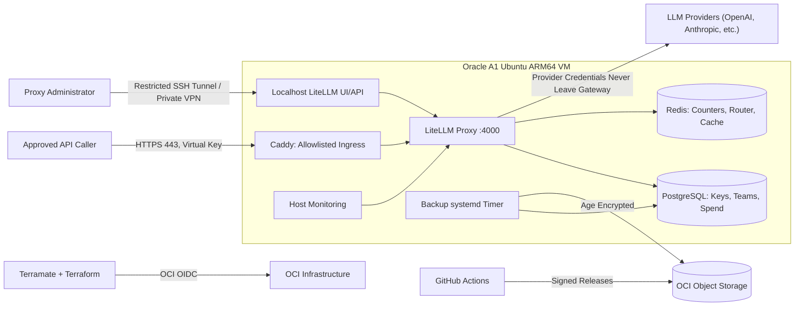

# llm-gateway

Administrator-managed LiteLLM Proxy on Oracle Cloud Infrastructure (OCI) Always Free ARM64.

## Overview

This gateway exposes a stable, authenticated OpenAI-compatible HTTPS API to approved users and services, centralizes upstream model credentials, and enforces per-key/team access and spending limits.

## Architecture



- **Compute**: `VM.Standard.A1.Flex` (2 OCPU, 12 GB RAM, ARM64)
- **Gateway**: LiteLLM Proxy
- **Data**: PostgreSQL + Redis
- **Ingress**: Caddy (TLS termination, ACME, route allowlist)
- **IaC**: Terramate + Terraform

## Developer Quickstart

The gateway provides a standard **OpenAI-compatible REST API**. You can use **any** AI agent framework, orchestration library, or HTTP client—including **LangChain, LangGraph, LlamaIndex, Antigravity SDK (ADK), CrewAI, AutoGen, or the standard OpenAI SDK**—simply by pointing the base URL to your gateway and passing your virtual key.

### 1. Request an API Key
Submit an access request via [Issues → New issue → Request Gateway Access](.github/ISSUE_TEMPLATE/access-request.yml). Once approved, the administrator will deliver your virtual key (`sk-...`) privately through an encrypted secret channel.

### 2. Available Model Aliases
Always request and call the abstract aliases (never upstream provider model IDs):
- `general-fast` — Fast general-purpose chat (e.g., GPT-4o-mini)
- `general-reasoning` — High-capability complex reasoning (e.g., GPT-4o)
- `structured-output` — Strict JSON schema mode
- `agent-tools` — Multi-step function and tool calling
- `rag-embedding` — Text embeddings (1,536 dimensions)

---

### 3. Framework Examples

> [!TIP]
> The gateway speaks standard HTTP/REST. You can use the lightweight **`litellm`** client directly, LangChain's **`ChatLiteLLM`**, or any other framework.

#### Option A: LiteLLM SDK (Python — No OpenAI SDK Needed)
```python
import litellm

# Chat completion using the LiteLLM client directly
response = litellm.completion(
    model="openai/general-fast",  # 'openai/' prefix configures the client wire format
    api_base="https://<YOUR_GATEWAY_DOMAIN>/v1",
    api_key="<YOUR_VIRTUAL_KEY>",
    messages=[{"role": "user", "content": "Explain quantum computing in one sentence."}],
)
print("Answer:", response.choices[0].message.content)

# Embeddings via LiteLLM
embed_response = litellm.embedding(
    model="openai/rag-embedding",
    api_base="https://<YOUR_GATEWAY_DOMAIN>/v1",
    api_key="<YOUR_VIRTUAL_KEY>",
    input=["Document text to embed for vector search"],
)
print("Vector dimensions:", len(embed_response.data[0]["embedding"]))  # 1536
```

#### Option B: LangChain with `ChatLiteLLM` (No `langchain-openai` Needed)
```python
from langchain_community.chat_models import ChatLiteLLM

llm = ChatLiteLLM(
    model="openai/general-fast",
    api_base="https://<YOUR_GATEWAY_DOMAIN>/v1",
    api_key="<YOUR_VIRTUAL_KEY>",
)

response = llm.invoke("What are the advantages of an API gateway?")
print(response.content)
```

#### Option C: LangGraph (Agent with Tool Calling)
```python
from langchain_community.chat_models import ChatLiteLLM
from langgraph.prebuilt import create_react_agent
from langchain_core.tools import tool

@tool
def get_weather(city: str) -> str:
    """Get the current weather for a city."""
    return f"The weather in {city} is sunny and 22°C."

model = ChatLiteLLM(
    model="openai/agent-tools",
    api_base="https://<YOUR_GATEWAY_DOMAIN>/v1",
    api_key="<YOUR_VIRTUAL_KEY>",
)

agent = create_react_agent(model, tools=[get_weather])
result = agent.invoke({"messages": [("user", "What's the weather in Tokyo?")]})
print(result["messages"][-1].content)
```

#### Option D: LlamaIndex (RAG & Embeddings)
```python
from llama_index.llms.openai import OpenAI
from llama_index.embeddings.openai import OpenAIEmbedding

llm = OpenAI(
    model="general-fast",
    api_base="https://<YOUR_GATEWAY_DOMAIN>/v1",
    api_key="<YOUR_VIRTUAL_KEY>",
)

embed_model = OpenAIEmbedding(
    model="rag-embedding",
    api_base="https://<YOUR_GATEWAY_DOMAIN>/v1",
    api_key="<YOUR_VIRTUAL_KEY>",
)

embeddings = embed_model.get_text_embedding("Semantic search document query")
print("Dimensions:", len(embeddings))  # 1536
```

#### Option E: TypeScript / Node.js
```typescript
import { ChatOpenAI } from "@langchain/openai";

const model = new ChatOpenAI({
  model: "general-fast",
  configuration: {
    baseURL: "https://<YOUR_GATEWAY_DOMAIN>/v1",
    apiKey: process.env.LLM_GATEWAY_KEY,
  },
});

const response = await model.invoke("Hello from TypeScript!");
console.log(response.content);
```

#### Option F: Raw cURL / HTTP (Zero Dependencies)
```bash
curl -X POST "https://<YOUR_GATEWAY_DOMAIN>/v1/chat/completions" \
  -H "Authorization: Bearer $LLM_GATEWAY_KEY" \
  -H "Content-Type: application/json" \
  -d '{"model": "general-fast", "messages": [{"role": "user", "content": "Hello!"}]}'
```

## Repository Structure

```
llm-gateway/
├── .github/                    # CI/CD workflows, issue templates, PR templates
├── infrastructure/             # Terramate + Terraform stacks & modules (OCI)
├── cloud-init/                 # VM bootstrap (cloud-init + systemd)
└── gateway/                    # LiteLLM proxy config, Compose, Caddyfile
```

## License

[MIT](LICENSE)
