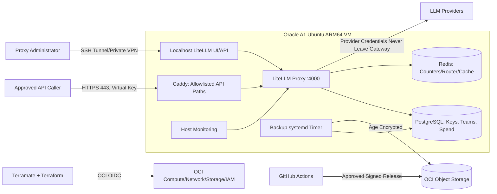

# Architecture Documentation

## System Overview

The llm-gateway is an administrator-managed LiteLLM Proxy service running on Oracle Cloud Infrastructure (OCI) Always Free tier, providing a stable, authenticated OpenAI-compatible HTTPS API to approved users and services.

## High-Level Architecture

## Component Details

### Compute
- **Instance**: OCI Always Free `VM.Standard.A1.Flex` (2 OCPU, 12 GB RAM, ARM64)
- **OS**: Ubuntu 24.04 LTS ARM64 (pinned OCID)
- **Boot Volume**: 100 GB (within free tier block quota)

### Network
- **VCN**: Single VCN (10.0.0.0/16)
- **Subnet**: Public subnet (10.0.1.0/24) with Internet Gateway
- **NSG**: Restrictive rules allowing only:
  - TCP 443 from 0.0.0.0/0 (HTTPS API)
  - TCP 80 from 0.0.0.0/0 (ACME HTTP-01 challenge)
  - TCP 22 from admin CIDR only (SSH)
- **No public access** to ports 4000 (LiteLLM), 5432 (PostgreSQL), 6379 (Redis), 9090 (Prometheus), 9100 (Node Exporter), 2019 (Caddy Admin)

### Services (Docker Compose)
| Service | Exposure | Dependencies | Persistence |
|---------|----------|--------------|-------------|
| `litellm` | 127.0.0.1:4000 (private) | PostgreSQL, Redis | None (stateless) |
| `postgres` | Internal Compose network | None | Named volume + daily backups |
| `redis` | Internal Compose network | None | Named volume |
| `caddy` | Host 80/443 | LiteLLM | ACME certificates |
| `node-exporter` | Host network | Host | None |

### Security Boundaries
1. **Public Ingress**: Only Caddy on 80/443 with explicit route allowlist
2. **Management Plane**: Accessible ONLY via SSH tunnel to localhost:4000
3. **Database**: PostgreSQL and Redis only on internal Compose network
4. **Secrets**: Never in Git, Terraform state, cloud-init, or CI logs
5. **Provider Credentials**: Injected at runtime via Docker secrets/environment

## Data Flow

### Request Flow (Inference)
1. Client → HTTPS 443 → Caddy (TLS termination)
2. Caddy → Route allowlist check → LiteLLM (localhost:4000)
3. LiteLLM → Auth (virtual key) → Rate limit (Redis) → Budget check (PostgreSQL)
4. LiteLLM → Provider credentials (decrypted from DB) → Upstream LLM API
5. Response → LiteLLM → Caddy → Client

### Management Flow
1. Admin → SSH tunnel → localhost:4000 → LiteLLM Admin UI/API
2. Admin creates teams, keys, budgets via UI or API
3. Keys delivered via approved secret-sharing channel

### Backup Flow
1. Daily systemd timer → `backup-postgres.sh`
2. `pg_dump` custom format → compress → age encrypt → OCI Object Storage
3. Manifest with SHA256 uploaded alongside
4. Lifecycle policy retains 7 daily + 4 weekly (within 20 GB quota)

## Trust Model

- **LiteLLM Proxy**: Official signed image, pinned by digest
- **OCI Infrastructure**: Terraform with OCI native backend, state locking
- **CI/CD**: GitHub Actions with OIDC federation (no long-lived keys)
- **Deployment**: VM pulls signed release via instance principal
- **Recovery**: Off-VM encrypted backups, offline age private key

## Failure Domains

| Component | Failure Impact | Recovery |
|-----------|----------------|----------|
| OCI A1 Instance | Complete outage | Re-provision from Terraform, restore DB from backup |
| PostgreSQL | No auth, budgets, keys | Restore from encrypted backup |
| Redis | Rate limiting degraded | Recreate (ephemeral), LiteLLM fail-closed mode |
| Caddy | No TLS/ingress | Restart, ACME renewal automatic |
| Upstream Provider | Model unavailable | Fallback models, circuit breaker |
| OCI Reclaim | Instance lost | Same as instance failure |

## Capacity Planning

- **Memory Envelope** (12 GB total):
  - LiteLLM: ~5 GiB
  - PostgreSQL: ~1.5 GiB
  - Redis: ~0.5 GiB
  - Caddy: ~0.25 GiB
  - Exporters/Logging: ~0.5 GiB
  - OS/Page Cache/Burst: ~3 GiB (reserved)

- **Storage**: 100 GB boot volume, 20 GB Object Storage (shared)

- **Scaling Triggers**:
  - Sustained CPU >80% → Consider paid instance
  - Memory >80% → Reduce workers or upgrade
  - Disk >75% → Alert, >85% → Critical
  - Backup age >26h → Alert