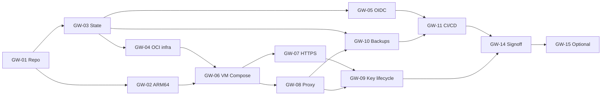

# Gateway engineering backlog — implementable issue specifications

**Status:** proposed issues only. Not filed in GitHub and not implemented. **Scope:** infrastructure and LiteLLM gateway; excludes downstream application migrations. Refer to [IMPLEMENTATION_PLAN.md](../IMPLEMENTATION_PLAN.md) for target architecture and policy.

All issues must include: code/configuration reviewed by CODEOWNERS; no production secrets in commits, plans or CI logs; automated tests demonstrating acceptance; documentation and rollback procedures as appropriate. Dependencies are hard release gates, not necessarily sequential engineering scheduling.

## Milestone M0 — Platform contracts and compatibility

### GW-01 [P0] Repository foundation, ownership and engineering baseline

**Depends on:** none. **Deliverables:** root README, operator documentation, `docs/USER_README.md`, CODEOWNERS, SECURITY.md, `.gitignore`, sample nonsecret configuration, issue form, license, pinning policy, pull-request template, branch protections and workflow-call integration with centralized `ci-workflows` pinned by SHA.

**Implementation:** Create the proposed tree; document which tool owns each layer (Terramate and Terraform for OCI, cloud-init for host initialization, Compose for services, LiteLLM for models and keys). Add linters for HCL, YAML, Compose, shell and Markdown; run `gitleaks` or equivalent against history and changed files. Make the public documentation safe to share even when the IaC and operator material live in a private repository.

**Acceptance:** no secret values checked in; tests and docs validation run on every PR; review protections cover `.github`, infrastructure, deployment and policy files; request form is selectable through Issues; no unrelated consumer code.

### GW-02 [P0] Native ARM64 image, migrations and software supply-chain qualification

**Depends on:** GW-01. **Deliverables:** pinned image digest and release provenance matrix covering LiteLLM, PostgreSQL, Redis, Caddy and backup/monitoring tools; reproducible native ARM64 test workflow.

**Implementation:** Inspect multiarchitecture manifests and provenance/signatures according to the upstream release's documented trust root. Pin *digest* and verify that the chosen image runs natively on `ubuntu-24.04-arm` and actual Oracle A1. Launch an isolated PostgreSQL and Redis; execute the LiteLLM version's documented migration process; serve chat, embeddings, models and scoped keys against a mock provider. Test a same-release restart and failed-migration path. Reject QEMU emulation as a substitute.

**Acceptance:** native `aarch64` process proven; no missing Prisma/native library binaries; image verification succeeds; migrations, key generation, revocation and model calls pass; unverified image updates blocked.

## Milestone M1 — OCI infrastructure

### GW-03 [P0] Free-tier guardrails and remote Terraform backend bootstrap

**Depends on:** GW-01. **Deliverables:** documented one-time OCI bootstrap procedure, dedicated compartment, bucket(s) for Terraform state, backup/release prefixes, object versioning, lifecycle, IAM and account budget alarms.

**Implementation:** Confirm home region and A1 availability; create remote-state bucket outside the managed stack. Select Terraform >=1.12 with the **OCI native backend** and verify state locking in a simultaneous-operation test. No state, plan or bootstrap credentials in Git. Define storage lifecycle with total-version-size monitoring, and recovery from the previous state object. Account for A1 and boot volume quotas and avoid non-free add-ons (load balancers, NAT gateways and excess block volumes).

**Acceptance:** remote state locked/versioned; state restore drill documented; unauthorized identity denied; budget and free-quota checks performed before any apply; no bootstrap circular dependency.

### GW-04 [P0] Terramate production stack and Terraform OCI modules

**Depends on:** GW-03. **Deliverables:** one `production` Terramate stack with Terraform modules for VCN, subnet, route/IGW, NSG, A1 Compute, storage/IAM and basic alarms.

**Implementation:** Pin Terraform and OCI provider versions and `.terraform.lock.hcl`; select official compatible Ubuntu ARM64 image by reviewed OCID; set `VM.Standard.A1.Flex` to 2 OCPU and 12 GB and boot volume to 100 GB by default. NSG allows only 443, HTTP for validated ACME flow and administration from an explicit restricted source if SSH is used. DB, Redis, LiteLLM and metrics are never assigned public ingress. Instance principal receives only required object permissions. Provide an exact resource-cost inventory in plan output.

**Acceptance:** `terramate list`, `terraform fmt/validate/plan` pass; real VM reports `aarch64`; security rules tested externally; outputs contain no secrets; plan creates no non-free resources without explicit approval; deletion and recovery paths documented.

### GW-05 [P0] GitHub Actions to OCI authentication and least privilege

**Depends on:** GW-03, GW-04. **Deliverables:** federated OCI workload identity and limited-role workflow access; emergency recovery identity runbook.

**Implementation:** Follow OCI's documented GitHub OIDC JWT-to-RPST exchange, verify support in the pinned OCI Terraform provider/CLI and backend, and constrain trust to exact owner/repository, protected ref and environment claims. Give plan read-only infrastructure privileges, apply narrow mutation rights and release-upload separate object-store rights. Bootstrap federation manually with a different privileged identity. Fail closed if claim exchange cannot be demonstrated; do not put OCI API private keys into regular PR workflows.

**Acceptance:** authorized production job authenticates without a long-lived CI API key; untrusted PR/ref fails; no privileged credentials exposed through log/artifact surfaces; CI reads remote state without broad tenancy access.

## Milestone M2 — Host and proxy

### GW-06 [P0] Hardened ARM64 cloud-init and Docker Compose stack

**Depends on:** GW-02, GW-04. **Deliverables:** idempotent cloud-init, pinned Docker Engine and Compose, least-privilege host accounts, `systemd` units/timers, named volumes and health-gated Compose definitions.

**Implementation:** Install OS security upgrades; SSH public-key authentication only and disabled password/root SSH; limit network and Docker daemon exposure; persist LiteLLM, PostgreSQL, Redis and Caddy volumes. Bind LiteLLM to `127.0.0.1:4000` for private administrator tunneling and a private Compose network for Caddy-to-LiteLLM. Configure per-service memory, CPU, pids and log limits; preserve room for host cache, migrations and backup bursts. Provision all runtime secrets outside cloud-init user data, Terraform state and GitHub logs.

**Acceptance:** cold boot and reboot recover healthy services, while a missing required secret prevents serving; containers do not run overcommit configuration; 4000/5432/6379 and admin paths cannot be reached publicly; persistent DB data survives a Compose upgrade.

### GW-07 [P0] Public HTTPS inference and private administration

**Depends on:** GW-06. **Deliverables:** Caddy config, DNS and ACME automation, public route allowlist, management network documentation and ingress conformance tests.

**Implementation:** Expose 443 only for approved OpenAI-compatible routes (`/v1/chat/completions`, `/v1/embeddings`, `/v1/models` initially; further routes require tests). HTTP 80 exists only as needed for certificate issuance and redirect. Explicitly deny unknown paths, Swagger, Admin UI and all key/team/user/config/spend management endpoints, regardless of user token type. Administrators connect to localhost LiteLLM via verified SSH tunnel or approved private network. Protect streaming timeouts and request body sizes without breaking SSE.

**Acceptance:** valid virtual key succeeds on authorized inference paths; anonymous request fails; an admin master key still cannot reach blocked public admin URLs; TLS renewal and streaming tests pass; default route is deny.

### GW-08 [P0] Proxy release, model aliases, migrations and failure policies

**Depends on:** GW-02, GW-06. **Deliverables:** Git-managed LiteLLM model catalog, approved model aliases, provider secret injection, independent migration job and release manifest.

**Implementation:** Set `LITELLM_MASTER_KEY`, `LITELLM_SALT_KEY`, `DATABASE_URL` securely; treat salt key as durable recovery secret. Use `DISABLE_SCHEMA_UPDATE=true` for serving containers and run migrations once per release. Model aliases are capability contracts, not promises of feature parity. Validate upstream structured JSON, function calling, streaming and embeddings on chosen providers before activating each alias. Configure bounded provider retries and cost-safe fallbacks, and keep the model catalog's source of truth singular (Git unless an explicit DB-management policy is adopted).

**Acceptance:** deterministic restart on pinned image digest; schema migration has a gate and recovery procedure; allowed aliases succeed against mock/low-cost live provider; unsupported feature fails rather than silently downgrading; no provider secrets appear in files, plan output or logs.

### GW-09 [P0] Administrator-managed virtual-key lifecycle and user documentation

**Depends on:** GW-07, GW-08. **Deliverables:** `docs/USER_README.md`, `docs/KEY_POLICY.md`, `docs/ADMIN_KEY_RUNBOOK.md`, `.github/ISSUE_TEMPLATE/access-request.yml`, key create/revoke administration scripts, and nonsecret audit ledger.

**Implementation:** GitHub issue collects owner identity, purpose, sensitivity, allowed aliases and operations, per-minute rate, monthly budget, environment and expiration—never secrets. Admin manually verifies requester, assigns an approved owner/team, `allowed_routes=["llm_api_routes"]`, specific models, spending/rate ceilings, expiration, and tests denied management routes and unauthorized models. Deliver generated virtual keys only via an approved private one-time secret-sharing tool; do not automate issuance from untrusted GitHub issue input. Include renewal, rotation, suspected-compromise and revocation workflows.

**Acceptance:** request → approval → issued key → privately delivered → basic inference → denied model/admin route → rotation/revocation all demonstrated; README curl and Python examples function after replacing documented placeholders; public issue exposes no raw key.

## Milestone M3 — Recovery, monitoring and deployment automation

### GW-10 [P0] Off-VM encrypted backups and verified restore

**Depends on:** GW-03, GW-06, GW-08. **Deliverables:** scheduled `pg_dump` custom-format backups, client-side encryption, Object Storage upload/checksums, quota-aware retention, independent decryption secret escrow and tested restore procedure.

**Implementation:** Daily dump and encrypt using a recovery public key; do not retain recovery private key on VM. Upload via narrowly scoped instance identity, verify remote object metadata and cryptographic digest and alert if backup missing/stale. Protect original salt/master/provider-credential recovery material outside VM. Retain nominal 7 daily and 4 weekly points only while under total free-object quota; never delete last verified backup. Perform isolated restore with matching/migrated proxy version and prove model/key records can be recovered.

**Acceptance:** automated off-host encrypted backup, accurate freshness alert, successful quarterly restore drill, and documented VM-loss recovery; RPO target 24 h, RTO target 4 h best effort, not SLA.

### GW-11 [P1] Protected GitHub Actions plan/apply/release/deploy workflows

**Depends on:** GW-05, GW-08, GW-10. **Deliverables:** CI lint/security/tests, native ARM64 qualification, distinct plan and approved apply pipelines, release distribution and deployment acknowledgment.

**Implementation:** Integrate reviewed reusable `ci-workflows` at SHA, but keep infrastructure security-sensitive workflows local. Use remote state lock and concurrency controls; run read-only `terraform plan` in trusted CI; preserve reviewed exact plan in short-lived encrypted authorized storage; apply only after protected environment approval. OCI deploy VM pulls signed approved manifests/config and digest-pinned images via instance principal rather than exposing SSH to all GitHub runners. Backup database before migration, gate on health/auth tests, and document an operator-led schema rollback.

**Acceptance:** untrusted PR cannot access OCI or provider credentials; reviewed plan matches applied commit and state; failed deployment retains/reverts to functioning release when safe; no auto `terraform destroy`; signed release provenance verified.

### GW-12 [P1] Low-overhead monitoring and operator alerts

**Depends on:** GW-06, GW-08, GW-10. **Deliverables:** external availability probe, internal readiness metrics, host disk/memory/process checks, spend and backup freshness alerts, channel/recipient configuration and runbook.

**Implementation:** Use native OCI monitoring plus lightweight local exporters/scripts initially. Alert on endpoint 5xx, provider timeout/429 spikes, excessive latency, disk >75% warning/>85% critical, memory >80% sustained, certificate expiry, stale backups and model spending nearing configured ceilings. Avoid installing heavy dashboards/trace stacks until resource measurements justify them. Redact prompts, credentials and personally identifiable data from metrics/logs.

**Acceptance:** inject a synthetic provider outage, stopped proxy, expired-backup marker and disk warning and demonstrate notifications; alerts contain actionable context without secrets; monitoring overhead fits resource budget.

### GW-13 [P1] Drift detection, upgrades, disaster and break-glass runbooks

**Depends on:** GW-04, GW-08, GW-10, GW-11. **Deliverables:** full-stack (not changed-only) scheduled drift checks and documented operating procedures for provider failures, Oracle reclaim, database corruption, compromised key, cert renewal, OCI IAM and Terramate state recovery.

**Implementation:** Run periodic refresh/full plans against each state and report drift without applying. Require release notes, snapshot, explicit migration and test gates for gateway upgrades. Explain that previous binary version may not support migrated DB schema; rollback may require DB restore. Verify a paid-VM fallback is technically possible even though not provisioned. Audit and prune stale keys and secrets monthly.

**Acceptance:** deliberate test drift produces alert; no automatic infrastructure mutation; tabletop incident and full test restoration completed; upgrade and rollback steps documented with clear decision points.

### GW-14 [P1] Security, performance and failure-mode launch sign-off

**Depends on:** all P0 and GW-11, GW-12. **Deliverables:** dated sign-off with reproducible test report, current configuration hashes, issue tracker, exceptions and mitigation owners.

**Implementation:** Use synthetic provider load to measure p50/p95/p99, concurrent requests, RAM growth, CPU, proxy queueing, key/revocation enforcement and 429 behavior. Test wrong model, malformed auth, budget exhaustion, slow provider, DB/Redis failures, restart, A1 VM reboot, HTTPS invalidity and storage exhaustion. Prove no public admin access even when master key is supplied. Set SLOs based on measurements rather than inventing capacity.

**Acceptance:** no unresolved critical/high findings; load test fits 2 OCPU/12 GB; recoverability tests pass; cost/free-tier boundaries reviewed; launch approval recorded.

### GW-15 [P2] Optional Terramate Cloud and advanced traces

**Depends on:** GW-14. **Deliverables:** opt-in Terramate Cloud integration and optionally Langfuse/OpenTelemetry export, with retention, resource, privacy and cost analysis.

**Implementation:** Evaluate whether this adds enough value beyond GitHub/OCI metrics to justify external exposure and on-VM overhead. Use free plans only within documented limits. Prefer hosted external dashboards or off-VM collectors over running heavy analytics on the constrained gateway instance.

**Acceptance:** basic gateway works identically when optional systems are disabled; no additional cost or content logging enabled without approval.

## Dependency summary

**Definition of done for the project:** A signed, native-ARM64 LiteLLM Proxy running behind TLS with PostgreSQL and Redis on an Always Free-eligible OCI A1 instance; locked remote IaC state; administrator-only management; approved virtual-key requests, private delivery and revocation; daily encrypted off-host backups with successful restore; protected CI/CD; and verified operational alerts. No consumer repository changes are included.
